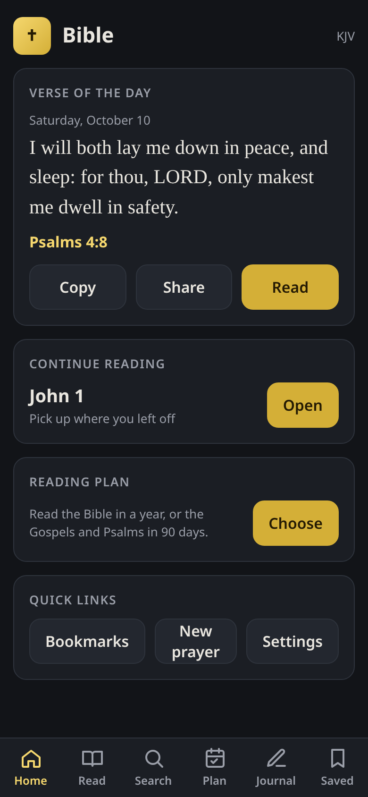
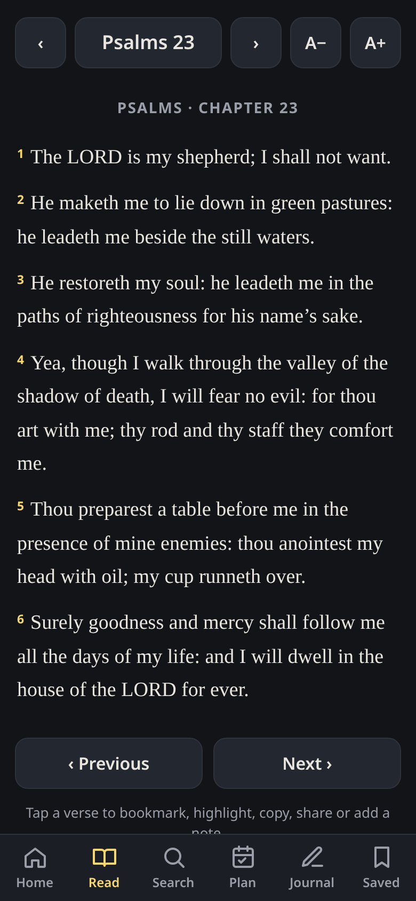

# Bible

Free, offline Bible app (KJV) with a daily verse, reading plans, and a prayer journal. No ads, no accounts.

Open it here: [https://alfredgoing81-prog.github.io/Apps/](https://alfredgoing81-prog.github.io/Apps/)

After the first visit the Bible text is saved on your device, so you can keep reading with no connection.

## Add to Home Screen

**Android (Chrome)**

1. Open the link above in Chrome.
2. Tap the menu (three dots) and choose **Install app** or **Add to Home screen**.
3. Confirm. A Bible icon appears on your home screen and opens full screen.

**iPhone (Safari)**

1. Open the link above in Safari.
2. Tap the Share button, then **Add to Home Screen**.
3. Tap **Add**. Open Bible from your home screen.

## Your data stays on your device

Bookmarks, highlights, reading-plan progress, and prayer-journal entries are stored only on your device. Nothing is sent to a server, and there is no account to create.

## Scripture text

The King James Version text is public domain, from [aruljohn/Bible-kjv](https://github.com/aruljohn/Bible-kjv).

## Screenshots

